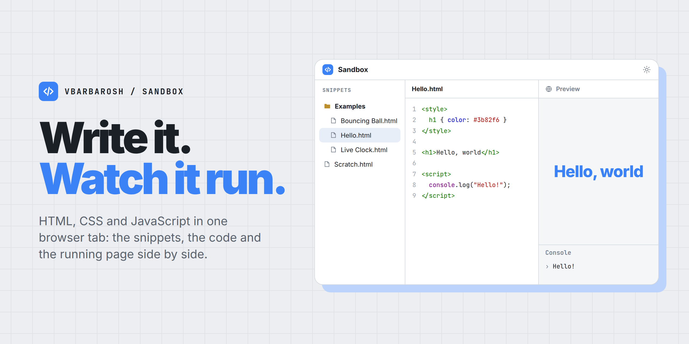

<picture>
  <source media="(prefers-color-scheme: dark)" srcset="img/cover-dark.png">
  
</picture>

# sandbox

A sandbox in one browser tab: write HTML, CSS and JavaScript and watch it run beside the code.

## Quick start

The whole app is one page, `src/index.html`: open it in a browser.

```sh
git clone https://github.com/vbarbarosh/sandbox.git
xdg-open sandbox/src/index.html
```

## Documentation

Full documentation: **[docs/README.md](docs/README.md)**

## License

[MIT](LICENSE)
